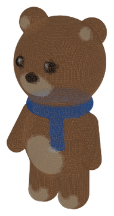
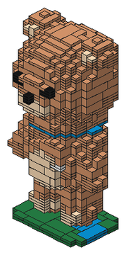

# image-to-bricks

Turn pictures of a character, or a coloured 3D model (GLB), into a LEGO build with step-by-step instructions.

Two steps, each usable on its own:

1. **Pictures -> 3D model** (`images_to_model.py`, NVIDIA GPU, Linux or WSL2): 1-4 pictures of a character (front, and
   optionally left, back, right) become a cleaned, coloured, watertight GLB. Shape from
   [TRELLIS.2-4B](https://github.com/microsoft/TRELLIS.2) (front picture), colours projected from all pictures. Every
   model comes with a licence package (`NOTICE.md`, `PROVENANCE.json`). Built with DINOv3.
2. **3D model -> bricks** (`model_to_bricks.py`, any computer): the GLB becomes the build and its instructions.

`images_to_bricks.py` runs both in one go.

The model is voxelised into plate-sized cells, its surface colours are matched to the LEGO palette, and the cells are
packed into real bricks and plates. Repair passes then tie loose or weakly attached parts to the rest. An optional stand
keeps the figure from tipping over. The output is a parts list, a top-down map per layer, 3D step views and an
instruction PDF. With your own brick inventory (`--stock`) it builds with the pieces you own and lists only the pieces still to buy.

## Example

The bear test figure (`tests/fixtures/public/bear.glb`), built 16 studs wide on a 2-plate stand with a pond:
1,033 pieces, 72 plate layers, one instruction page per layer.

| Input model | LEGO build |
|---|---|
|  |  |

A page of the instructions: the parts to place, a 3D view of the build so far, and the top-down map of the layer
(`2x3B` = a 2 x 3 brick, sizes without B are plates):


The command:

```
python model_to_bricks.py tests/fixtures/public/bear.glb --rotate-x 90 --target-studs 16 --voxel-supersample 3 --hollow --shell 2 --colors "Nougat,Light Nougat,Dark Azure,Black,White" --trim-colors "Dark Azure" --trim-snap 12 --base 2 --base-shape rounded --base-color Green --base-zone "Dark Azure=pond:right:18" --front down --tie-recolor 10 --cleanup-small --fill-pinholes 3 --anchor-floating 2 --merge-plates --pdf --outdir lego_output_bear
```

## Install

One virtual environment, `.venv` in the project folder, runs everything. The brick step installs anywhere; the model
step needs an NVIDIA GPU and Linux, or WSL2 on Windows, and is added to the same `.venv` by a script.

### Brick step only (Windows, Linux, macOS)

Python 3.12 or newer.

```
python -m venv .venv
.venv\Scripts\activate          (Windows; on Linux / macOS: source .venv/bin/activate)
pip install -r requirements.txt
```

`requirements.txt` pins every package to the versions the regression tests were frozen with; other versions of numpy,
scipy or OpenCV can change the result slightly.

### Model step (pictures -> 3D model): Linux, or WSL2 on Windows

Needs an NVIDIA GPU with a driver >= 570 (checked on an RTX 5090), about 25 GB of disk, and once, by hand:

```bash
sudo apt install -y build-essential git curl libgl1 libglib2.0-0
curl -LsSf https://astral.sh/uv/install.sh | sh
# CUDA toolkit 12.8 (nvcc): https://developer.nvidia.com/cuda-12-8-0-download-archive
#   (on WSL2 choose "WSL-Ubuntu": the toolkit only, the driver is the Windows one)
```

TRELLIS.2 uses Meta's DINOv3 image encoder, which is gated on Hugging Face. Once per person: create an account
(https://huggingface.co/join), accept the licence on https://huggingface.co/facebook/dinov3-vitl16-pretrain-lvd1689m
(approval can take a while), create a "Read" token (https://huggingface.co/settings/tokens) and log in:
`uvx --from huggingface_hub hf auth login` (or `export HF_TOKEN=hf_...`). `uvx --from huggingface_hub hf auth whoami`
shows whether you are logged in. The login is only needed for the download; afterwards everything runs offline.

```bash
bash scripts/setup_images_to_model.sh            # adds the model step to .venv (creates it, Python 3.12, if missing)
bash scripts/reproduce_images_to_model.sh        # robot, frog, bear -> PASS/FAIL against the saved results (~5 min)
.venv/bin/python tests/test_images_to_bricks_gpu.py   # pictures -> model -> bricks, end to end (~3 min)
```

The setup checks the Hugging Face access first, then installs exactly what `lock/images_to_model/` lists (with
`--no-deps`, compared against the lock at the end): torch 2.7.1 + CUDA 12.8, TRELLIS.2, CuMesh and FlexGEMM at fixed
commits built for your GPU, and the model files at fixed revisions, each checked against its content hash (in
`.models/`, used offline). No NVIDIA research-only code (nvdiffrast, nvdiffrec) is installed, and a check confirms none
is loaded. `--fresh` rebuilds `.venv`; `VENV=.venv-images bash scripts/setup_images_to_model.sh` puts the model step
in an environment of its own.

**Windows:** the model step runs in WSL2. In PowerShell: `wsl --install -d Ubuntu-24.04`, then in Ubuntu clone the
repository into your Linux home folder (building on `/mnt/c` is very slow) and follow the Linux steps above. The brick
step also runs natively on Windows with its own `.venv`: make the GLB in WSL2 and build it on Windows
(`\\wsl$\Ubuntu-24.04\home\<you>\image-to-bricks\...`), or run `images_to_bricks.py` in WSL2 for both steps.

## Quick start

Build the robot test figure (12 studs wide, on a 2-plate stand) with a PDF:

```
python model_to_bricks.py tests/fixtures/public/robot.glb --rotate-x 90 --target-studs 12 --base 2 --pdf --outdir lego_output_robot
```

The output folder holds `robot_inventory.csv` (parts list), `robot_instructions.pdf`, the layer maps and step views in
`layers/`, flat front / back / left / right views, a stability report and `run_log.txt`. Use a new `--outdir` for
every run.

Useful options (all of them: `python model_to_bricks.py --help`):

| Option | What it does |
|---|---|
| `--target-studs N` | width of the build in studs |
| `--rotate-x / -y / -z DEG` | turn the model upright first (many GLB files are Y-up) |
| `--hollow --shell N` | hollow the inside, keep N studs of wall |
| `--colors "Red,Black,..."` | only these palette colours |
| `--base N` | stand of N plates under the figure (`--base-shape rounded`, `--base-color Green`, ...) |
| `--stock FILE.csv` | build from the pieces you own; writes a stock report and a buy list |
| `--pdf` | instruction PDF |
| `--front down` | mark where the figure's face looks on every layer map |

## Pictures to bricks in one command

```
python images_to_bricks.py --views tests/fixtures/public/characters/robot --outdir out_robot -- --target-studs 12 --base 2
```

`--views` is a folder with `front.png` and optionally `left.png`, `back.png`, `right.png`; or give the files one by one
with `--front` (required), `--left`, `--back`, `--right`. Pictures with a transparent background are used as they are;
on a plain background the character is cut out with u2net. Everything after `--` goes to `model_to_bricks.py`.
`--rotate-x 90` (the GLB is y-up), `--front` (found by the colour projection) and `--pdf` are set for you; the same
options after `--` win. Use a new `--outdir` every time:

- `out_robot/model/robot.glb`, `robot_package/` (`NOTICE.md`: what you may do with the model, required credits;
  `PROVENANCE.json`: every model and library with versions and licences) and `robot_work/` (cut-outs, meshes,
  `report.json`)
- `out_robot/bricks/`: the build, as with `model_to_bricks.py` (parts list, layer maps, `robot_instructions.pdf`)

Put a `SOURCE.json` next to the pictures (`source`, `author`, `licence`, `notes`; see
`tests/fixtures/public/characters/robot/SOURCE.json`); without it the notice says the rights to the pictures are
unknown.

Each step on its own:

```
python images_to_model.py --views tests/fixtures/public/characters/robot --output out_model/robot.glb --height 0.3
python model_to_bricks.py out_model/robot.glb --rotate-x 90 --front down --target-studs 12 --pdf --outdir out_bricks
```

## Your own bricks (`--stock`)

The stock file is a CSV with one line per piece kind:

```
piece_type,width_studs,depth_studs,height_plates,color_name,quantity,shape
Plate,2,1,1,Red,20,
Brick,4,2,3,Black,6,
```

`tests/fixtures/public/stock.csv` is an example. `my_bricks_catalog/` has the scripts to keep such a catalogue
(`build_catalog.py`), edit it (`stock_editor.html`) and price the missing pieces of a build (`check_cost.py`, see
`check_cost.md`).

## Colouring a plain mesh

`tools/colorize_mesh.py` colours an untextured mesh from a few photos of the same object (plain background):

```
python tools/colorize_mesh.py model.glb photo1.png photo2.png photo3.png --outdir colorize_output --debug
```

It calibrates a camera per photo by silhouette matching and projects the photo colours onto the vertices. It needs
OpenGL (pyrender); see the script's help for the options.

## Tests

```
python tests/run_all.py
```

runs every test file (about 2 minutes). The golden builds in `tests/fixtures/public/` freeze the exact result of three
option-heavy builds, so any change in output shows up. The model step is tested without a GPU (fake shape model, real
clean-up, colour projection and licence package); `tests/test_images_to_bricks_gpu.py` runs it for real and is skipped
until the GPU setup is done. See `tests/README.txt`.

Development checks (`pip install -r requirements-dev.txt`): `pre-commit run --all-files` runs ruff, mypy, vulture and
basic file checks; CI runs the same plus the tests on Linux, Windows and macOS (Python 3.12 and 3.13).

## License

GPL-3.0-or-later, see `LICENSE`. The model step uses third-party models and libraries under their own licences, see
`THIRD_PARTY_NOTICES.md`; models made with it must show the credit "Built with DINOv3".
