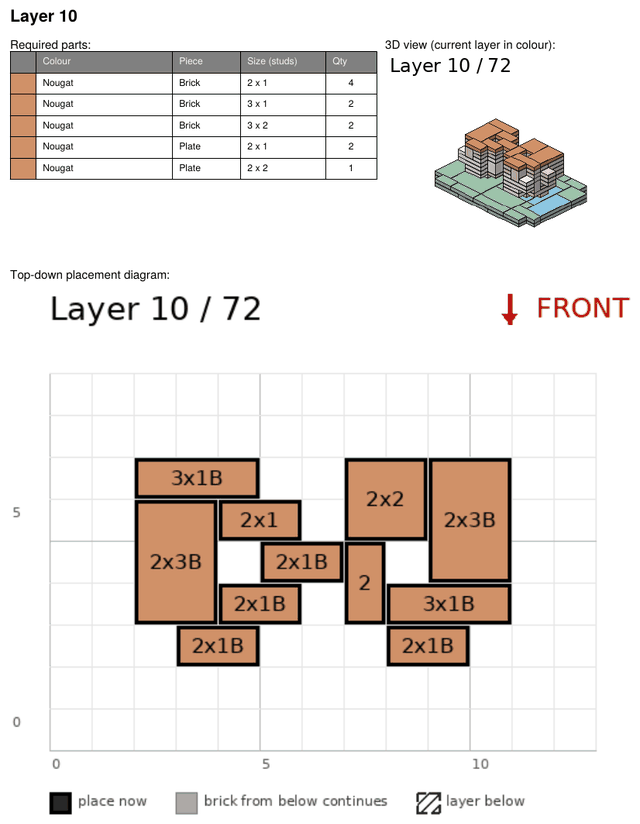

# image-to-bricks

Turn a coloured 3D model (GLB) into a LEGO build with step-by-step instructions.

The model is voxelised into plate-sized cells, its surface colours are matched to the LEGO palette, and the cells are
packed into real bricks and plates. Repair passes then tie loose or weakly attached parts to the rest. An optional stand
keeps the figure from tipping over. The output is a parts list, a top-down map per layer, 3D step views and an
instruction PDF. With your own brick inventory (`--stock`) it builds with the pieces you own and lists only the pieces still to buy.

## Example

The bear test figure (`tests/fixtures/public/bear.glb`), built 16 studs wide on a 2-plate stand with a pond:
1,033 pieces, 72 plate layers, one instruction page per layer.

| Input model | LEGO build |
|---|---|
|  |  |

A page of the instructions: the parts to place, a 3D view of the build so far, and the top-down map of the layer
(`2x3B` = a 2 x 3 brick, sizes without B are plates):



The command:

```
python model_to_bricks.py tests/fixtures/public/bear.glb --rotate-x 90 --target-studs 16 --voxel-supersample 3 --hollow --shell 2 --colors "Nougat,Light Nougat,Dark Azure,Black,White" --trim-colors "Dark Azure" --trim-snap 12 --base 2 --base-shape rounded --base-color Green --base-zone "Dark Azure=pond:right:18" --front down --tie-recolor 10 --cleanup-small --fill-pinholes 3 --anchor-floating 2 --merge-plates --pdf --outdir lego_output_bear
```

## Install

Python 3.12 or newer.

```
python -m venv .venv
.venv\Scripts\activate          (Windows; on Linux / macOS: source .venv/bin/activate)
pip install -r requirements.txt
```

`requirements.txt` pins every package to the versions the regression tests were frozen with; other versions of numpy,
scipy or OpenCV can change the result slightly.

## Quick start

Build the robot test figure (12 studs wide, on a 2-plate stand) with a PDF:

```
python model_to_bricks.py tests/fixtures/public/robot.glb --rotate-x 90 --target-studs 12 --base 2 --pdf --outdir lego_output_robot
```

The output folder holds `robot_inventory.csv` (parts list), `robot_instructions.pdf`, the layer maps and step views in
`layers/`, flat front / back / left / right views, a stability report and `run_log.txt`. Use a new `--outdir` for
every run.

Useful options (all of them: `python model_to_bricks.py --help`):

| Option | What it does |
|---|---|
| `--target-studs N` | width of the build in studs |
| `--rotate-x / -y / -z DEG` | turn the model upright first (many GLB files are Y-up) |
| `--hollow --shell N` | hollow the inside, keep N studs of wall |
| `--colors "Red,Black,..."` | only these palette colours |
| `--base N` | stand of N plates under the figure (`--base-shape rounded`, `--base-color Green`, ...) |
| `--stock FILE.csv` | build from the pieces you own; writes a stock report and a buy list |
| `--pdf` | instruction PDF |
| `--front down` | mark where the figure's face looks on every layer map |

## Your own bricks (`--stock`)

The stock file is a CSV with one line per piece kind:

```
piece_type,width_studs,depth_studs,height_plates,color_name,quantity,shape
Plate,2,1,1,Red,20,
Brick,4,2,3,Black,6,
```

`tests/fixtures/public/stock.csv` is an example. `my_bricks_catalog/` has the scripts to keep such a catalogue
(`build_catalog.py`), edit it (`stock_editor.html`) and price the missing pieces of a build (`check_cost.py`, see
`check_cost.md`).

## Colouring a plain mesh

`tools/colorize_mesh.py` colours an untextured mesh from a few photos of the same object (plain background):

```
python tools/colorize_mesh.py model.glb photo1.png photo2.png photo3.png --outdir colorize_output --debug
```

It calibrates a camera per photo by silhouette matching and projects the photo colours onto the vertices. It needs
OpenGL (pyrender); see the script's help for the options.

## Tests

```
python tests/run_all.py
```

runs every test file (about 2 minutes). The golden builds in `tests/fixtures/public/` freeze the exact result of three
option-heavy builds, so any change in output shows up. See `tests/README.txt`.

Development checks (`pip install -r requirements-dev.txt`): `pre-commit run --all-files` runs ruff, mypy, vulture and
basic file checks; CI runs the same plus the tests.

## License

GPL-3.0-or-later, see `LICENSE`.
